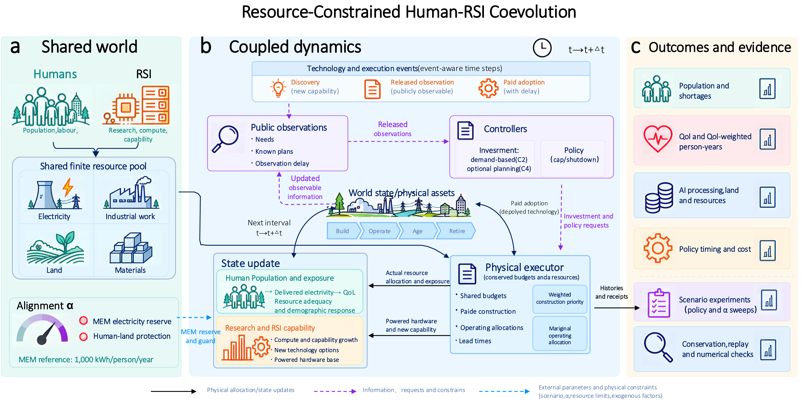

# Our Turn

**A simulation framework for coupled human–AI resource dynamics and coevolution**

[](LICENSE)
[](requirements.txt)
[](package.json)
[](#-running-tests)

---

## 📖 Overview

As autonomous artificial intelligence systems scale, their physical operations interact directly with the thermodynamic and spatial resources that sustain human civilization: **electrical grid power, semiconductor fabrication throughput, industrial labor, and terrestrial land area**. 

`our-turn` provides an open-source, multi-scale dynamical simulation framework modeling the multi-decade coevolution of human populations and autonomous compute infrastructure under physical resource constraints, capital depreciation lags, and institutional regulatory pathways.

The repository provides two complementary simulation environments:
- **Core Engine (JavaScript / Node.js ES Modules)**: A discrete-event and continuous dynamical system featuring tri-cohort capital aging, multi-region max-flow spatial transmission networks (7-hex grid), and an interactive browser-based decision platform.
- **Continuous ODE Model (Pure Python)**: A self-contained ordinary differential equation system solved via SciPy `solve_ivp` (RK45) with marginal resource arbitration and automated unit testing.

---

## ✨ Key Features

- ⚡ **Coupled Physical Ledger**: Tracks joint allocation of finite electrical power, semiconductor manufacturing throughput, industrial labor, and terrestrial land without double-counting.
- 🌐 **Spatial Network Transmission**: 7-region continental grid with inter-regional power transfers dispatched via the Edmonds-Karp maximum-flow algorithm.
- 🏛️ **Institutional Governance**: Evaluates stateful policy interventions (hardware caps, emergency shutdown trials, modern energy reserves) subject to observation delays and administrative lead times.
- 👥 **Demographic Feedback**: Human quality-of-life (QoL) empirical satiation coupled with an inertia-buffered shortfall mortality differential equation.
- 🖥️ **Interactive Web Studio**: Zero-dependency browser console with real-time trajectory visualization, interactive playback, and paired counterfactual scenario branching.
- 🧪 **Exhaustive Test Coverage**: Over 590 automated tests validating physical conservation laws, numerical stability, and API boundaries.

---

## ⚙️ Model Architecture

<p align="center">
  
</p>
<p align="center"><em>Figure: Operational pipeline and subsystem coupling of the human–AI resource coevolution framework.</em></p>

```
                       ┌─────────────────────────────────────────────────────────┐
                       │           Shared Finite Resource Ledger (t)             │
                       │     Grid Power G(t)  |  Land A_total  |  Work W(t)      │
                       └────────────────────────────┬────────────────────────────┘
                                                    │
                 ┌──────────────────────────────────┴──────────────────────────────────┐
                 ▼                                                                     ▼
   ┌───────────────────────────┐                                         ┌───────────────────────────┐
   │  Human Demography & MEM   │                                         │   Tri-Cohort Capital      │
   │  R_E = α · e_MEM · max(H) │                                         │   Power Plants  (50 yr)   │
   │  QoL Satiation & Adequacy │                                         │   Chip Fabs     (30 yr)   │
   │  Shortfall Exposure ODE   │                                         │   Hardware      ( 8 yr)   │
   └─────────────┬─────────────┘                                         └─────────────┬─────────────┘
                 │                                                                     │
                 │              Contested Surplus Power Arbitration                    │
                 └──────────────────────────────►◄─────────────────────────────────────┘
                                   σ(Δ) = 1 / (1 + exp(-kΔ))
                                                │
                                                ▼
                               ┌─────────────────────────────────┐
                               │  Grid Maintenance Loop (Feed)   │
                               │  Compute Services Power Grid    │
                               └─────────────────────────────────┘
```

### Core Mechanisms

1. **Tri-Cohort Capital Turnover**: Infrastructure is modeled across three distinct capital vintages: Power Generation ($P$, 50-year lifespan / 4-year construction delay), Semiconductor Fabs ($F$, 30-year lifespan / 4-year delay), and Computing Hardware ($H$, 8-year lifespan / 1-year delay). Decommissioned assets enter a mandatory remediation queue recovering 60% of embodied materials.
2. **Modern Energy Minimum (MEM) Statutory Allocation**: The alignment parameter $\alpha \in [0, 1]$ ring-fences non-negotiable electrical power $R_E(t) = \alpha \cdot e_{\text{MEM}} \max(H(t), H_0)$, where $e_{\text{MEM}} = 1{,}000$\,kWh/person/year.
3. **Marginal Priority Power Allocation**: Flexible electricity beyond statutory reserves is arbitrated via a smooth logistic marginal priority function:
   $$\sigma(\Delta) = \frac{1}{1 + \exp(-k \Delta)}, \qquad \Delta = \frac{\partial \text{QoL}}{\partial E_H} - \lambda \frac{\partial (\dot{Q}/Q)}{\partial E_{\text{AI}}}$$
4. **Buffered Demographic Shortfall Dynamics**: Shortfalls in electricity ($s_E$) and land ($s_L$) accumulate into systemic exposure $E_D(t)$ via an inertia ODE ($\tau_D = 2.0$\,yr):
   $$\frac{dE_D}{dt} = \frac{\max\bigl(0, 1 - \min(s_E, s_L)\bigr) - E_D}{\tau_D}, \qquad \frac{dH}{dt} = H(t)\left[b_0 - \mu_0\bigl(1 + c_E E_D(t)\bigr)\right]$$

---

## 📦 Installation

Clone the repository and install Python dependencies:

```bash
git clone https://github.com/Slian22/our-turn-model.git
cd our-turn-model

# Install Python dependencies
pip install -r requirements.txt
```

Prerequisites:
- **Python**: $\ge 3.10$
- **Node.js**: $\ge 18.0.0$

---

## ⚡ Quickstart

### 1. Python Simulation API

Run a simulation directly in Python:

```python
from python.model import RSIParameters, Policy, simulate_rsi

# Initialize default parameters
params = RSIParameters()

# Configure policy: 50% alignment reserve, hardware cap at Year 5
policy = Policy(
    alignment=0.5,
    compute_cap=500.0,
    cap_start_year=5.0
)

# Run 50-year continuous ODE simulation
trajectory = simulate_rsi(params, policy, horizon=50.0)

# Inspect outcomes
final_state = trajectory.state[-1]
print(f"Final Human Population Ratio: {final_state[0]:.3f}")
print(f"Final Compute Hardware Ratio: {final_state[1]:.3f}")
print(f"Final Grid Capacity Ratio:    {final_state[3]:.3f}")
```

Or run the CLI parameter explorer:

```bash
python3 python/run_model.py --quick
```

### 2. Interactive Web Decision Console

The interactive simulation studio runs locally in any modern browser with zero build steps:

```bash
# Start a local HTTP server
python3 -m http.server 8000
```

Open the following interfaces in your browser:
- **Spatial Multi-Region Canvas**: [http://localhost:8000/console/world.html](http://localhost:8000/console/world.html)
- **Policy & Capital Control Console**: [http://localhost:8000/console/revised.html](http://localhost:8000/console/revised.html)
- **Macro Telemetry & Comparison Viewer**: [http://localhost:8000/console/index.html](http://localhost:8000/console/index.html)

---

## 📁 Repository Structure

```
our-turn-model/
├── revised/            # Core dynamical simulation kernel (ES Modules)
│   ├── engine.mjs      # Simulation orchestrator & discrete-event loops
│   ├── dynamics.mjs    # State differential equations & resource ledger
│   ├── assets.mjs      # Tri-cohort capital pipelines & remediation queues
│   ├── welfare.mjs     # Human QoL satiation & demographic exposure ODE
│   ├── marginal-priority.mjs # Marginal allocation logistic function
│   ├── policy.mjs      # 4-stage regulatory lifecycle & shutdown logic
│   ├── config.mjs      # Physical & thermodynamic calibrated parameters
│   └── math.mjs        # Numerical integration routines (Euler / RK-adaptive)
├── spatial/            # Multi-regional 7-hex spatial network
│   ├── world.mjs       # Regional simulation engine
│   ├── allocation.mjs  # Edmonds-Karp max-flow power routing
│   └── grid.mjs        # Hexagonal topology & link capacities
├── sim/                # Core global simulation baseline
├── python/             # Pure-Python continuous ODE implementation
│   ├── model.py        # Complete differential equation dynamical system
│   ├── run_model.py    # CLI runner & parameter explorer
│   ├── parameters.json # Calibrated physical parameters
│   └── test_model.py   # Python test suite
├── console/            # Browser-based Interactive Decision Studio
│   ├── world.html      # 7-Hex regional canvas & power flow visualizer
│   ├── revised.html    # Capital cohort & policy control console
│   └── index.html      # Macro telemetry & counterfactual scenario comparator
├── figure/             # System architecture and pipeline diagrams
│   ├── coupled_architecture.png
│   └── coupled_architecture.pdf
├── revised-tests/      # Engine unit and integration tests
├── spatial-tests/      # Spatial max-flow and network consistency tests
├── requirements.txt    # Python package dependencies
├── pyproject.toml      # Python packaging configuration
├── package.json        # Node.js project manifest & test scripts
├── LICENSE             # MIT License
└── README.md           # Documentation
```

---

## 🧪 Running Tests

### JavaScript / Node.js Test Suite

Run all test suites across the engine, spatial network, and console components:

```bash
npm test
```

Or run individual suites:

```bash
# Core engine tests (400+ tests)
npm run test:revised

# Spatial grid and max-flow network tests (80+ tests)
npm run test:spatial

# Console UI component tests (100+ tests)
npm run test:console
```

### Python Test Suite

Run the Python verification tests:

```bash
python3 python/test_model.py
```

---

## 📄 License

This project is licensed under the [MIT License](LICENSE).
